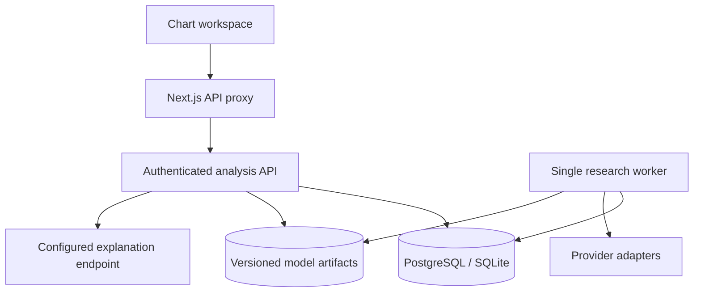

# Architecture and implementation plan

## Running components

The browser renders a Next.js / TypeScript application. The same-origin Next API proxy forwards authenticated requests to a private FastAPI service. A separate Python worker claims queued ingestion and training jobs. Both use SQLAlchemy with PostgreSQL in Compose or SQLite for local development. Artifacts live in a shared persistent directory.

Training and ingestion are outside request handling. The scanner currently reads cached observations serially and is suitable only for the six-instrument registry. No LLM calls occur during scanning or polling. LLM explanations are explicitly requested by the user.

## Schema

| Table | Identity | Contents / constraints |
|---|---|---|
| candles | Unique `(symbol, timeframe, time)` | Completed OHLCV, source, fetch timestamp; no synthetic rows. |
| records | String ID | Kind, owner, symbol, creation time, serialized evidence; update/delete rejected by database trigger. |
| jobs | UUID | Ingest/train action, instrument/timeframe, queued/running/completed/failed, timestamps and bounded failure detail. |
| workspaces | Owner + instrument | JSON drawing anchors and settings; last update timestamp. |

The initial schema is created by `db.init()` using SQLAlchemy metadata, with explicit immutable-record trigger installation. There is no incremental schema migration history yet. Back up the database before upgrades; an Alembic migration baseline is a remaining production requirement. Shared data/model records are system-owned; personal plans and events are filtered by authenticated owner.

## Failure behavior

- No credentials: an explicit provider-access error.
- HTTP failure: bounded retry for transient responses; permanent failures are surfaced without response bodies/credentials.
- Bad OHLCV: ingestion transaction rejected.
- Provider historical revisions: transaction rejected pending reconciliation; old evidence is not rewritten.
- Missing model/features: no inference and an honest readiness state.
- Old model: inference expires after 30 days. This is an age limit, not a statistical drift monitor.
- Missing explanation service: structured quantitative evidence remains available.
- Worker restart: interrupted running jobs marked failed; explicit retry required.
- Duplicate queued action: reuse existing job. This is best-effort API deduplication, not a distributed queue guarantee.

## Delivery sequence

1. This implementation: build/test the local research workflow and publish the source.
2. Connect user-authorized feeds; verify metadata, session calendars, corporate actions and complete histories. Run a real training/evaluation cycle and retain the data snapshot.
3. Add walk-forward validation, executable bid/ask and execution-time agreement. Release actionable signals only after predefined evidence thresholds.
4. Complete chart/workspace parity, benchmarks, point-in-time universe, events, alerts and portfolio controls.
5. Harden identity, queue, storage migrations, operational monitoring and backup recovery. Conduct load testing and jurisdiction-specific review before public deployment.

No Cloudflare/Sites deployment was attempted: this requested architecture includes a long-running Python worker, PostgreSQL and model artifacts, which are not supplied by merely publishing a static chart page.
